# AFD — App & Architecture Flow Document (Ruang Iklan)

**Produk:** Ruang Iklan untuk Bunda Journal  
**Versi:** 0.1 (draft review) · **Tanggal:** 16 Nov 2026  
**Dokumen terkait:** [PRD](./PRD.md) · [TRD](./TRD.md) · [IPD](./IPD.md) · [CALCULATOR-SPEC](./CALCULATOR-SPEC.md)

---

## 1. Aktor & hak akses

| Aktor | Bisa lihat | Bisa usul aksi | Bisa eksekusi | Bisa ubah setting | Catatan |
|---|---|---|---|---|---|
| **Owner (Ashr)** | Semua | Ya | Ya (approve) | Ya | Satu-satunya manusia yang menekan tombol |
| **Viewer** (opsional) | Semua | Tidak | Tidak | Tidak | V1.1, read-only |
| **Analis AI** | Data agregat via tool | Ya (`action_propose`) | **Tidak** | Tidak | Tidak punya token |
| **Studio OpenCode** | Kode + context snapshot | Ya (lewat skrip) | Tidak (merge butuh owner) | Worktree saja | Localhost |
| **Scheduler** | Status sync | Tidak | Tidak | Tidak | Hanya `/sync/cron` |
| **Sistem alert** | Metrik | Tidak | Tidak | Aturan saja | Mengirim notifikasi |

**Aturan keras:** token Meta hanya di server. AI, Studio, dan browser tidak pernah
menerima token. Aksi tulis selalu lewat `meta_actions` + approval owner.

---

## 2. Peta route

```
/ads                     Hari Ini
/ads/iklan               Iklan (query: ?tab=kampanye|kreatif|breakdown)
/ads/iklan?campaign=...  Detail campaign (drawer/di URL)
/ads/uang                Uang (query: ?tab=produk|order|rekonsiliasi)
/ads/rencana             Rencana (query: ?calc=breakeven&scenario=...)
/ads/pengaturan          Pengaturan (query: ?tab=koneksi|sync|...)
/ads/studio              Studio OpenCode (full screen, lokal)
```

Panel Analis tidak punya route sendiri; state disimpan di query `?ai=open&thread=...`
supaya bisa di-bookmark. Mobile memakai sheet, bukan route baru.

---

## 3. First-run: onboarding koneksi Meta

### 3.1 Alur

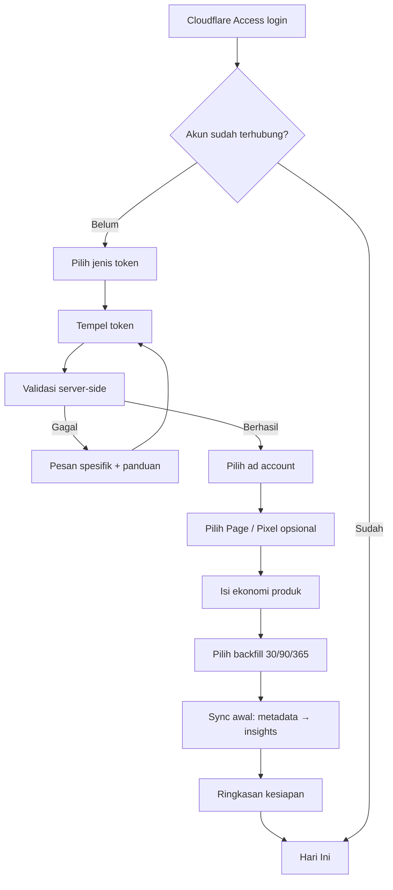

### 3.2 Langkah & validasi

| Langkah | Yang terjadi | Validasi | Gagal → |
|---|---|---|---|
| 1. Access | OTP email owner | JWT valid, email allowlist | 403, tidak ada data |
| 2. Pilih token | System User / User / Page | Info konsekuensi tiap jenis | — |
| 3. Tempel | Input password, tidak disimpan | Format token, panjang, tidak ada spasi | “Token tidak valid” |
| 4. Validasi | `debug_token`, `me`, `adaccounts` | `ads_read`, akun aktif, currency | Pesan sesuai error |
| 5. Pilih akun | List ad account | Status aktif, bukan agency | “Tidak ada akun” |
| 6. Page/Pixel | Opsional | Page milik business, pixel milik akun | “Boleh dilewati” |
| 7. Ekonomi | 4 produk prefilled | Harga >0, COGS ≥0, fee 0–5%, refund 0–20% | Badge asumsi |
| 8. Backfill | 30/90/365 | Estimasi + rate limit | “Mulai 30 hari dulu” |
| 9. Sync | Progress | Bisa ditinggal, resume | Retry / lanjut nanti |
| 10. Selesai | Checklist kesiapan | Token, akun, data, ekonomi | Link ke yang kurang |

### 3.3 Deteksi jenis token

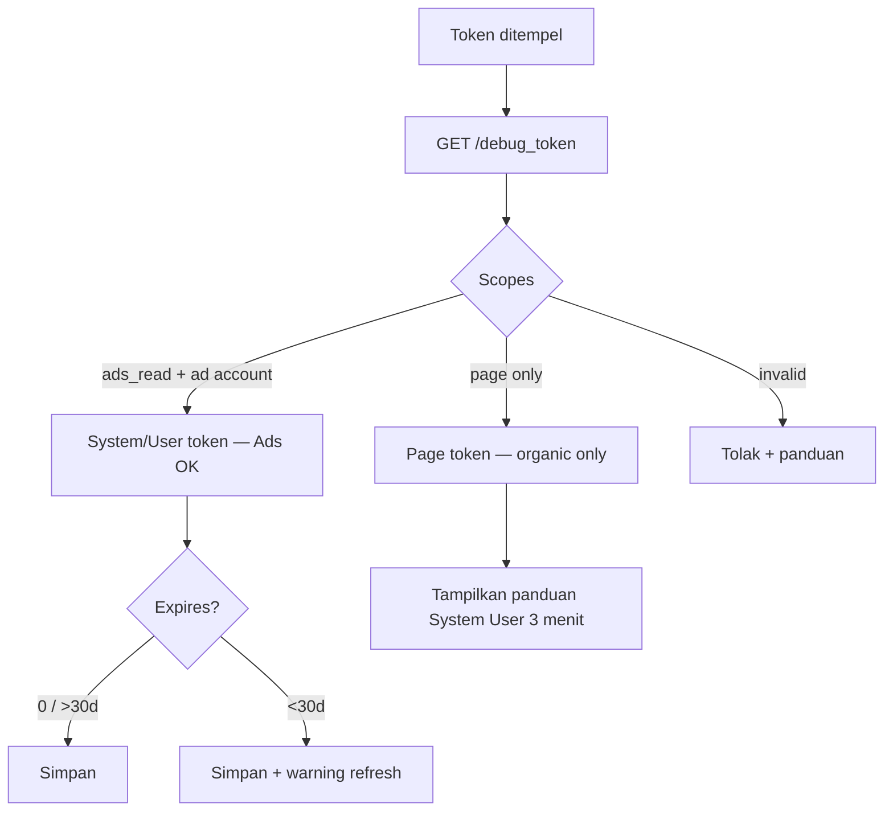

### 3.4 Empty & error states

| State | Tampilan | Aksi |
|---|---|---|
| Belum ada akun | “Hubungkan akun Meta untuk mulai.” | CTA “Hubungkan” + panduan |
| Token invalid | “Token tidak aktif. Buat token baru di Business Settings.” | Link + retry |
| Page token | “Token ini hanya membaca Halaman. Ads Insights butuh System User token.” | Panduan langkah |
| Scope kurang | “Butuh `ads_read`. Scope sekarang: …” | Daftar scope |
| Tidak ada ad account | “Tambahkan ad account ke Business Manager, lalu coba lagi.” | Panduan |
| Currency != IDR | “Akun memakai USD. Kalkulator Rp butuh kurs.” | Input kurs |
| Sync 0 baris | “Akun terhubung, belum ada spend.” | Ke Iklan |
| Backfill gagal sebagian | “12 dari 30 hari berhasil. Coba lagi chunk yang gagal.” | Retry chunk |

---

## 4. Loop harian (happy path)

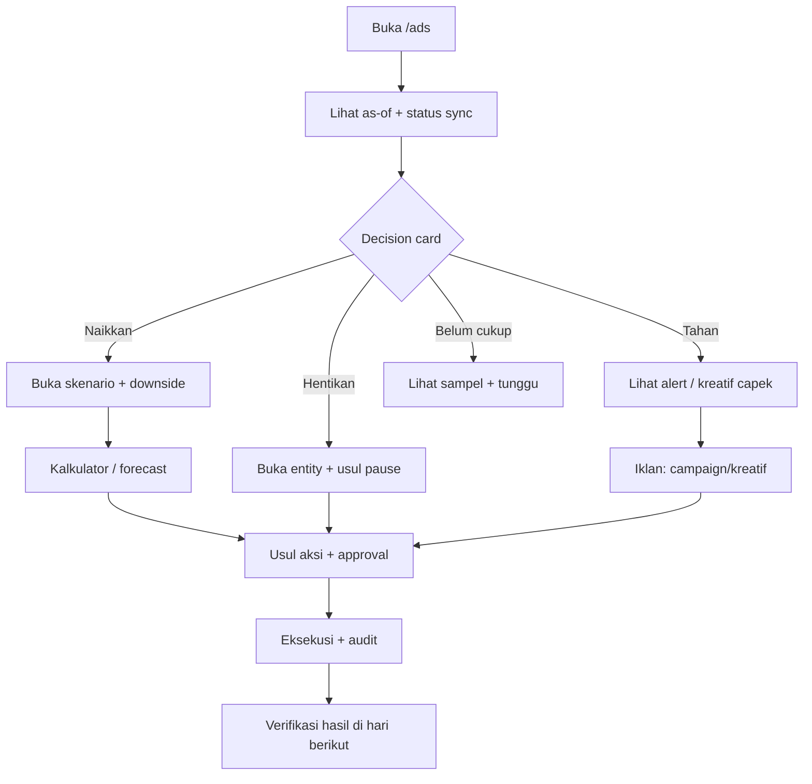

**Target waktu:** ≤5 menit dari buka sampai keputusan tercatat. Kalau lebih, dashboard
terlalu ramai.

### 4.1 Urutan baca yang disarankan

1. **As-of** — data baru?
2. **Decision card** — apa yang harus dilakukan?
3. **Alert** — ada yang mendesak?
4. **Uang vs Meta** — apakah angkanya bisa dipercaya?
5. **Perlu keputusan** — entity mana?
6. **Kreatif capek** — perlu brief baru?
7. Selesai. Jangan scroll semua chart.

---

## 5. Investigasi campaign

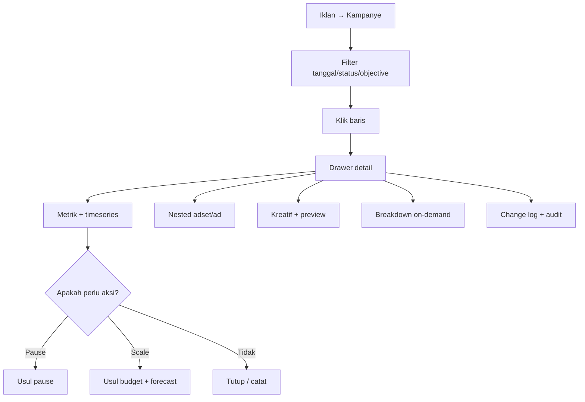

### 5.1 Detail drawer — isi

- Header: nama, status, objective, budget, decision badge.
- 4 metrik: spend, order bank, CPA bank, ROAS bank.
- Timeseries + annotation perubahan budget.
- Tab: Adset · Ad · Kreatif · Breakdown · Change log.
- Footer: as-of, sumber, “Buka di Meta Ads Manager” (deep link, opsional).
- Aksi: Usul pause/resume/scale; Duplicate (P1).

### 5.2 Aturan interaksi

- Klik baris membuka drawer, bukan pindah halaman (kecuali deep link).
- Filter disimpan di URL.
- Sorting/filtering tidak memanggil Meta; hanya D1.
- “Refresh” memanggil Meta dengan cooldown 60 detik.
- Aksi dari drawer selalu proposal; tidak ada eksekusi langsung.

---

## 6. Diagnosis kreatif

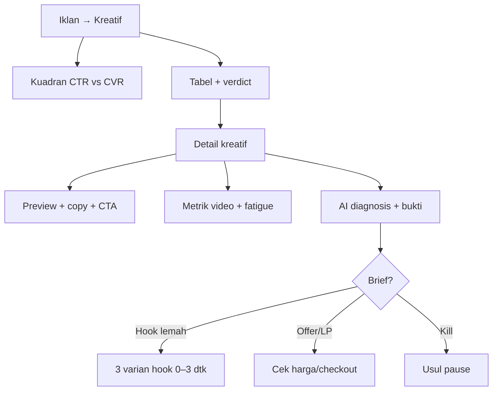

**Aturan sample:** jangan memberi verdict sebelum 5.000 impressions / 300 outbound
clicks / 25 LPV / 10 order. UI menampilkan “belum cukup data” dan menyembunyikan
tombol kill.

**Kuadran:**

| Kuadran | CTR | CVR | Arti | Aksi |
|---|---|---|---|---|
| Kiri atas | Rendah | Tinggi | Hook lemah, produk cocok | Ganti hook/thumbnail |
| Kanan atas | Tinggi | Tinggi | Winner | Scale + iterasi |
| Kiri bawah | Rendah | Rendah | Tidak cocok | Kill |
| Kanan bawah | Tinggi | Rendah | Offer/LP salah | Cek harga, checkout, pesan |

---

## 7. Uang: produk, order, rekonsiliasi

### 7.1 Produk

```
Uang → Produk
[Essential] [VIP] [Upgrade] [Hardcover]
Harga | COGS | Ongkir | Fee | Refund | Pajak
→ Kontribusi/order | CM% | BE ROAS | BE CPA | Max CPA
[Badge asumsi] [Lihat perhitungan] [Simpan]
```

Validasi:

- Harga >0; COGS ≥0; COGS < harga (kalau ≥, peringatan merah).
- Fee 0–5%; refund 0–20%; pajak 0–20%.
- Jika `Max CPA ≤0`, tampilkan “tidak layak diiklankan”.
- Perubahan biaya langsung memengaruhi kalkulator + decision card; tampilkan
  “Angka keputusan berubah” sebelum simpan.

### 7.2 Order CSV

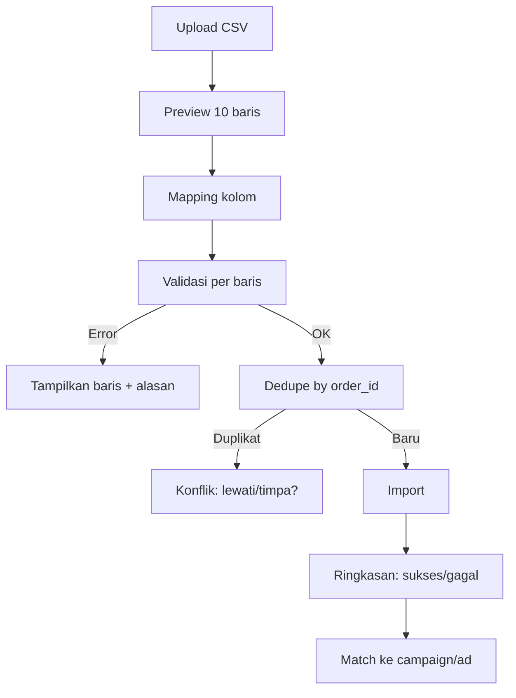

Kolom minimum: `order_id, product, gross, status, paid_at`. Opsional: `fee, refund,
campaign_id, utm_source, utm_campaign, ad_id`.

### 7.3 Rekonsiliasi

```
Uang → Rekonsiliasi
[Tanggal] [Meta: 24 order / Rp2.8jt] vs [Bank: 18 order / Rp2.1jt]
Gap: +33% (Meta overclaim) → pakai bank
[Chart gap harian] [Unmatched bank 2] [Klaim Meta tanpa bank 6]
[Match manual] [Tandai organic/WA] [Export]
```

Aturan:

- Jangan pernah menimpa `gross`/`net` bank.
- Gap >20% = merah; 10–20% = kuning; <10% = hijau.
- Calibration factor hanya untuk forecast; label “estimasi”.
- Setiap match manual masuk audit.

---

## 8. Rencana: kalkulator & skenario

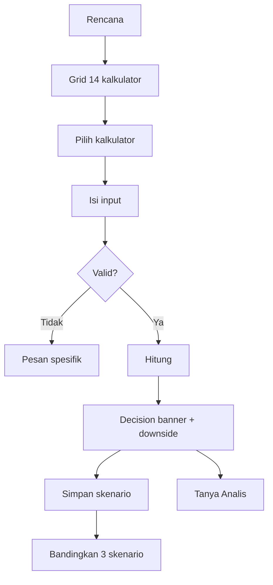

### 8.1 Layout drawer

```
┌ Kalkulator: Budget → Hasil ───────────────────────────┐
│ Input                        │ Hasil                  │
│ Budget/hari   [150.000]      │ Impressions 46.667     │
│ CPM           [45.000]       │ Klik 840               │
│ CTR           [1,8%]         │ LPV 588                │
│ LPV rate      [70%]          │ Order 17,6             │
│ CVR LPV       [3%]           │ Revenue Rp2,12jt       │
│ AOV           [120.000]      │ CPA Rp119rb            │
│                              │ ROAS 1,01x             │
│ [Reset] [Simpan]             │ Profit −Rp40rb         │
│                              │ ⚠ Jangan scale         │
└───────────────────────────────────────────────────────┘
```

### 8.2 Decision banner

- **Layak test** — CPA < Max CPA, ROAS > BE, sampel cukup.
- **Tahan** — sampel kurang / hasil di ambang.
- **Jangan scale** — ROAS < BE atau CPA > Max.
- **Tidak layak** — Max CPA ≤0 / COGS ≥ harga.

Setiap banner wajib menyebut **downside** dan **asumsi**.

---

## 9. Analis AI

### 9.1 Alur

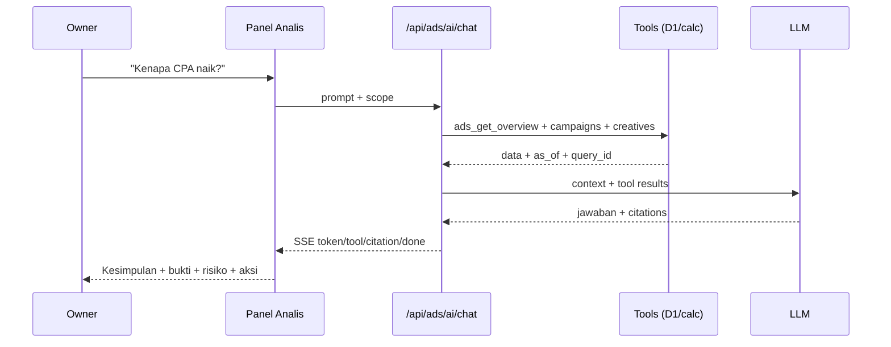

### 9.2 State panel

| State | Tampilan |
|---|---|
| Idle | Suggested prompts + scope chips |
| Streaming | Teks muncul, tool trace “Membaca insights…” |
| Tool error | Kotak error + request id + retry |
| Data stale | Banner kuning “data >6 jam” |
| Insufficient | “Belum cukup data: 6 order” + saran tunggu |
| Budget habis | “Batas AI harian tercapai” + reset besok |
| Provider down | “Analis sedang tidak tersedia” + coba lagi |

### 9.3 Interaksi wajib

- Setiap angka bisa diklik → buka tabel/drawer sumber.
- “Buat skenario” membuka kalkulator dengan input yang disebut AI.
- “Usulkan aksi” membuka approval modal, bukan eksekusi.
- “Salin” menyalin jawaban + sitasi.
- “Feedback” (V1.1) untuk menandai jawaban salah.

---

## 10. Studio OpenCode

### 10.1 Alur

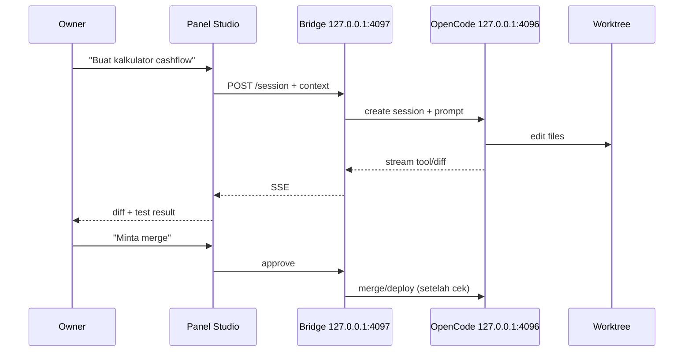

### 10.2 State

| State | Tampilan |
|---|---|
| Bridge off | “Studio offline” + perintah `npm run ads:studio` + fallback copy |
| OpenCode off | “OpenCode belum jalan” + link install |
| Session aktif | Chat + tool trace + diff |
| Test gagal | Output tes + file yang gagal |
| Merge menunggu | Tombol “Setujui merge” (owner) |
| Secret terdeteksi | Blokir + audit |

### 10.3 Fallback copy context

Tombol “Copy context ke OpenCode” menghasilkan:

```text
Kamu adalah analis Meta Ads Bunda Journal.
Scope: akun act_123, 2026-11-09..2026-11-16.
Aturan: baca CALCULATOR-SPEC.md, jangan mengarang angka, sitasi query_id.
Data snapshot:
{ ...agregat... }
Pertanyaan: ...
```

Tidak ada token/PII di clipboard. Cocok untuk OpenCode TUI di mana saja.

---

## 11. Approval aksi (state machine)

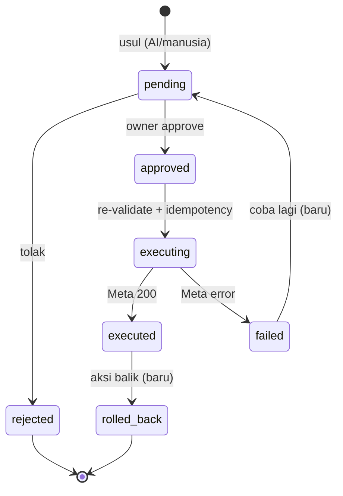

Aturan:

- `pending` bisa kedaluwarsa 24 jam.
- `approved` tidak otomatis eksekusi jika nilai berubah; minta konfirmasi ulang.
- `executed` tidak bisa diedit; rollback = aksi baru dengan alasan.
- Budget change >30% butuh ketik `SETUJU`; dampak >Rp500k butuh checkbox.

### 11.1 Isi modal

```
┌ Setujui perubahan ────────────────────────────────────┐
│ Naikkan budget adset "VIP-Interest-01"                │
│ Rp150.000 → Rp180.000 (+20%)                          │
│ Alasan: CPA bank 7d Rp58rb < Max Rp100rb, freq 1,8    │
│ Dampak: +6 order/minggu (estimasi)                    │
│ Downside: jika CPA naik 20%, laba turun Rp180rb       │
│ Batas Meta: 2/4 perubahan jam ini                     │
│ [ ] Saya paham risiko                                 │
│ [Tolak] [Setujui]                                     │
└───────────────────────────────────────────────────────┘
```

---

## 12. Sync (state machine)

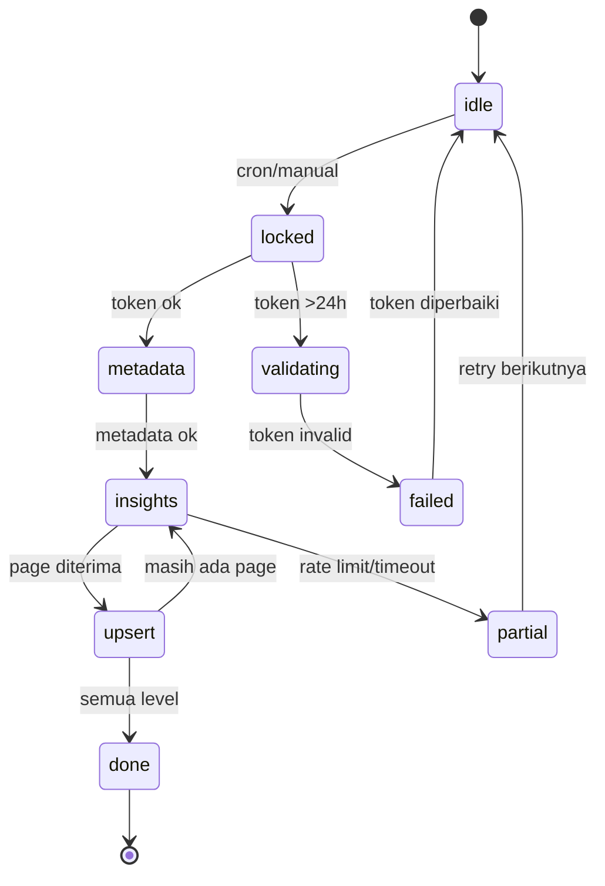

UI menampilkan:

- “Sync terakhir 08.30 WIB” + durasi.
- “Sedang sync…” + progress level.
- “Sebagian gagal: 3 dari 30 hari” + retry.
- “Rate limit: coba lagi 14.32” + penjelasan.
- “Token invalid” + CTA.

---

## 13. Wireframe kunci

### 13.1 Hari Ini (desktop 1440)

```
┌──────────────────────────────────────────────────────────────────────────┐
│ Ruang Iklan   [Bunda Journal ▾]  [7 hari ▾]   sync 08.30  [🔔 2] [AI] [S]│
├──────────────┬───────────────────────────────────────────────────────────┤
│ Hari Ini   ● │  ┌ Keputusan hari ini ───────────────────────────────────┐  │
│ Iklan        │  │  TAHAN                                                │  │
│ Uang         │  │  18 order bank — belum cukup untuk menilai.           │  │
│ Rencana      │  │  [CPA bank Rp58rb] [ROAS 1,9x] [Freq 1,8]             │  │
│ Pengaturan   │  │  [Lihat detail]  [Buat skenario]                      │  │
│              │  └───────────────────────────────────────────────────────┘  │
│              │  ┌ Laba bersih ┐ ┌ Spend ┐ ┌ CPA vs Max ┐ ┌ Order bank ┐  │
│              │  │ Rp4,2jt     │ │ Rp6,1jt│ │ 58 / 100rb │ │ 52        │  │
│              │  │ +12% 7d     │ │ +8%    │ │ aman       │ │ +9        │  │
│              │  └─────────────┘ └────────┘ └────────────┘ └───────────┘  │
│              │  ┌ Spend vs revenue vs profit ──────────────────────────┐  │
│              │  │        ╱╲      ╱╲                                   │  │
│              │  │  ╱╲╱╲╱  ╲╱╲╱  ╲  14 hari                              │  │
│              │  └───────────────────────────────────────────────────────┘  │
│              │  Perlu keputusan (3)              Kreatif capek (2)          │
│              │  • VIP-Interest-01 CPA 118rb     • Video-USG-02 freq 3,4    │
│              │  • HC-Retarget spend 310rb/0     • Static-01 CTR −34%       │
└──────────────┴───────────────────────────────────────────────────────────┘
```

### 13.2 Iklan — tabel

```
┌ Iklan ────────────────────────────────────────────────────────────────┐
│ [Kampanye] [Kreatif] [Breakdown]        [7 hari ▾] [Filter] [+ Kolom] │
├───────────────────────────────────────────────────────────────────────┤
│ Nama                  Status  Budget   Spend  Order  CPA   ROAS  Freq │
│ VIP-Interest-01       Aktif   250rb    1,8jt   31    58rb  1,9x  1,8  │
│ VIP-Testimoni-02      Aktif   150rb    1,2jt   18    67rb  1,8x  2,1  │
│ HC-Retarget           Aktif   100rb    310rb    0     —     —    3,4  │
│ Static-01             Aktif    75rb    240rb    3    80rb  1,4x  2,8  │
└───────────────────────────────────────────────────────────────────────┘
  Klik baris → drawer detail. Aksi selalu proposal.
```

### 13.3 Iklan — detail drawer

```
┌ VIP-Interest-01 ─────────────────────────────── [×] ┐
│ Aktif · Objective Sales · Budget Rp250.000/hari     │
│ [Tahan] CPA bank Rp58rb < Max Rp100rb, freq 1,8     │
│ Spend Rp1,8jt · Order 31 · ROAS 1,9x · CPA 58rb     │
│ ┌ timeseries ──────────────────────────────────────┐ │
│ └──────────────────────────────────────────────────┘ │
│ [Adset] [Ad] [Kreatif] [Breakdown] [Change log]      │
│ ...                                                  │
│ [Usul pause] [Usul +20%] [Buka di Meta]              │
└──────────────────────────────────────────────────────┘
```

### 13.4 Uang — produk

```
┌ Uang ────────────────────────────────────────────────────────────────┐
│ [Produk] [Order] [Rekonsiliasi]                                      │
├──────────────────────────────────────────────────────────────────────┤
│ Produk      Harga    COGS   Ongkir  Kontribusi  BE ROAS  Max CPA     │
│ Essential   49rb     0      0       47,7rb      1,03x    38,1rb     │
│ VIP         129rb    0      0       125,5rb     1,03x    100,4rb    │
│ Upgrade     80rb     0      0       77,8rb      1,03x    62,3rb     │
│ Hardcover   249rb    120rb  20rb    102,3rb     2,43x    81,8rb ⚠   │
│ ⚠ COGS hardcover masih asumsi. [Validasi]                            │
└──────────────────────────────────────────────────────────────────────┘
```

### 13.5 Rencana — grid

```
┌ Rencana ─────────────────────────────────────────────────────────────┐
│ Dasar                    Perencanaan              Skala              │
│ [Unit economics]         [Budget → hasil]         [Scale simulator]  │
│ [Blended AOV]            [Target → budget]        [Scenario compare] │
│ [Break-even]             [Pacing]                 [LTV / CAC]        │
│ [Max CPA]                [Cashflow cetak]         [Promo break-even] │
│ Diagnosa                 Uang                                         │
│ [Creative diagnostic]    [Rekonsiliasi]                               │
│ [Atribusi/EMQ]           [Forecast]                                   │
└──────────────────────────────────────────────────────────────────────┘
```

### 13.6 Panel Analis

```
┌ Analis ─────────────────────────────── [×] ┐
│ Scope: Bunda Journal · 7 hari · semua      │
│ as-of 08.30 WIB                             │
│ ┌ Suggested ──────────────────────────────┐ │
│ │ Kenapa CPA naik?                        │ │
│ │ Budget untuk 100 sales VIP?             │ │
│ └─────────────────────────────────────────┘ │
│ Kamu: Kenapa CPA naik minggu ini?           │
│ Analis:                                     │
│ Kesimpulan: CPA naik 18% karena ...         │
│ Bukti:                                      │
│ • CPA bank Rp78rb vs Rp66rb (7d, q_01J)    │
│ • Frekuensi 3,1 di Video-USG-02            │
│ • CTR turun 34% (q_01K)                    │
│ Risiko: 12 order, sampel lemah.             │
│ Aksi: [Usul pause Video-USG-02]             │
│ Data: q_01J, q_01K · 12 order · 08.30       │
└─────────────────────────────────────────────┘
```

### 13.7 Approval modal

```
┌ Setujui perubahan ──────────────────────────────┐
│ Naikkan budget VIP-Interest-01 +20%            │
│ Rp250.000 → Rp300.000                           │
│ Alasan: ROAS 7d 1,9x > BE 1,30x; CPA 58rb      │
│ Dampak: +6 order/minggu (estimasi)              │
│ Downside: jika CPA +20%, laba −Rp240rb          │
│ [ ] Saya paham risiko                           │
│ [Tolak] [Setujui]                               │
└─────────────────────────────────────────────────┘
```

### 13.8 Mobile 390

```
┌─────────────────────────────┐
│ Ruang Iklan      [🔔] [AI]  │
│ [7 hari ▾]  sync 08.30      │
├─────────────────────────────┤
│ TAHAN                       │
│ 18 order — sampel kurang.   │
│ [CPA 58rb] [ROAS 1,9x]      │
│ [Lihat detail]              │
├─────────────────────────────┤
│ Laba bersih   Rp4,2jt       │
│ Spend         Rp6,1jt       │
│ CPA / Max     58 / 100rb    │
│ Order         52            │
├─────────────────────────────┤
│ Perlu keputusan (3)         │
│ ...                         │
├─────────────────────────────┤
│ [Hari Ini] [Iklan] [Uang]   │
│ [Rencana] [Atur]            │
└─────────────────────────────┘
```

---

## 14. State inventory

| State | Kapan | Tampilan | Aksi |
|---|---|---|---|
| **Empty** | Belum ada akun/data | Instruksi + CTA | Hubungkan / sync |
| **Loading** | Fetch pertama | Skeleton layout | Tidak ada spinner |
| **Stale** | Data >6 jam | Banner kuning + as-of | Sync |
| **Partial** | Sebagian sync gagal | Banner + detail | Retry chunk |
| **Rate limited** | Meta 4/17/613 | Banner + waktu reset | Tunggu |
| **Insufficient** | Sampel < minimum | Card “belum cukup data” | Lihat sampel |
| **Error** | API/D1/AI gagal | Pesan + request id + retry | Retry |
| **Offline** | Browser offline | Banner | Jangan antre aksi |
| **Read-only** | Aksi belum aktif | Badge “read-only” | Lihat alasan |
| **Assumption** | COGS/fee belum validasi | Badge kuning | Validasi |
| **Empty filter** | Filter tidak ada hasil | “Tidak ada hasil” + reset | Reset |
| **Permission** | Scope kurang | Pesan scope + panduan | Perbaiki token |

---

## 15. Microcopy

| Konteks | Copy |
|---|---|
| Judul halaman | “Hari Ini” — bukan “Dashboard Overview” |
| Sync | “Tarik data” · “Sync terakhir 08.30 WIB” · “Sedang sync…” |
| Stale | “Data mungkin basi. Meta biasanya telat 15–30 menit.” |
| Gap | “Meta 24 order, bank 18. Selisih 33% — keputusan pakai bank.” |
| Insufficient | “6 order dalam 7 hari. Belum cukup untuk menyimpulkan.” |
| Assumption | “COGS cetak Rp120rb masih asumsi. Klik untuk validasi.” |
| Kill | “Hentikan adset ini? Spend Rp310rb tanpa order.” |
| Scale | “Naikkan +20%? Downside: laba turun Rp240rb jika CPA naik 20%.” |
| Approval | “Setujui perubahan” — bukan “OK” |
| AI error | “Analis tidak bisa mengambil data. Coba lagi. Ref: q_01J…” |
| Studio off | “Studio offline. Jalankan `npm run ads:studio` atau copy context.” |
| Access | “Masuk dengan email owner.” |

---

## 16. Mobile & aksesibilitas

- Bottom nav 5 item, label + ikon; target 44px.
- Tabel → kartu: nama, 3 metrik, verdict; tap → drawer.
- Chart tinggi 180px; sumbu disederhanakan; “Lihat tabel”.
- AI sheet full-screen; tombol tutup 44px; streaming `aria-live`.
- Kalkulator satu kolom; input `inputmode=numeric`; tidak auto-zoom (font 16px).
- Approval modal full-screen di mobile; tombol sticky bawah.
- Keyboard: Esc tutup; Tab urut; focus ring 2px sage; tidak ada trap.
- Kontras AA; status pakai ikon + teks, bukan warna saja.
- `prefers-reduced-motion`: matikan transisi.
- Tidak ada horizontal scroll 390px.
- Semua gambar punya `alt`; chart punya deskripsi teks.

---

## 17. Definition of done flow

- [ ] Onboarding bisa diselesaikan tanpa bantuan, dengan 6 error state yang jelas.
- [ ] Loop harian ≤5 menit; decision card selalu punya alasan + downside.
- [ ] Setiap angka bisa diklik ke sumber/as-of.
- [ ] Tidak ada aksi tulis tanpa approval.
- [ ] Kalkulator bisa disimpan, dibuka lagi, dan dibandingkan.
- [ ] AI selalu menyebut sampel + sumber; menolak jika data kurang.
- [ ] Studio offline tidak mematikan dashboard.
- [ ] Mobile 390px lolos tanpa scroll horizontal.
- [ ] Semua state di §14 punya desain, bukan hanya happy path.
